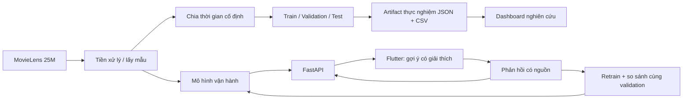

# MovieRS — Hệ khuyến nghị phim cá nhân hóa

MovieRS là dự án thực nghiệm hệ khuyến nghị phim kết hợp **SVD, Bayesian popularity và sở thích thể loại**, triển khai bằng **FastAPI + Flutter**. Người dùng có thể hiểu vì sao phim được gợi ý, đánh giá để cập nhật sở thích, hoặc bật khám phá đa dạng. Trình phát là mô phỏng để kiểm tra heartbeat, tiếp tục xem và phản hồi; không phát video thật.

Kế hoạch phát triển tiếp theo: [refactor quy trình nghiên cứu, dữ liệu và dashboard](report/REFACTOR_PLAN.md). Kế hoạch đề xuất mẫu 8.000 user / 1.237.592 rating từ toàn bộ ML-25M, cùng benchmark và tiêu chí nghiệm thu; các kết quả và lệnh bên dưới vẫn mô tả phiên bản đang có.

## Chủ đề và phạm vi

- **Bài toán nghiên cứu:** phân biệt độ chính xác dự đoán rating và chất lượng danh sách Top-K; đánh giá riêng người dùng chưa có lịch sử và đã có lịch sử.
- **Bài toán ứng dụng:** người mới nhận gợi ý theo thể loại và điểm cộng đồng; khi có vector người dùng, hệ thống kết hợp SVD với hồ sơ thể loại.
- **Đóng góp triển khai:** lý do gợi ý, tùy chọn MMR, phản hồi có nguồn/độ ưu tiên, cache đúng khi đổi sở thích và quy trình kiểm chứng có thể chạy lại.
- **Mức hoàn thiện:** bản demo học thuật có kiểm thử. Xác thực hiện vẫn là prototype bằng user ID, chưa có phiên/token và phân quyền production.

Không kết luận SVD tự giải quyết khởi động lạnh, không gọi proxy xem phim là nhãn sở thích thật, không dùng bảng điểm ghi cứng làm kết quả thực nghiệm.

## Kiến trúc



Luồng nghiên cứu đọc `ratings_processed.csv`, không dùng phản hồi demo. Luồng vận hành tiếp nhận phản hồi tài khoản app vào TRAIN. Hai luồng có mục đích khác nhau và không dùng chung kết quả để tuyên bố chất lượng học thuật.

## Kết quả đo thật ngày 15/10/2026

Đầu vào local: **2.000.000 rating**, 157.068 user, 13.163 phim có rating; danh mục metadata 62.316 phim. Chia thời gian toàn cục 80/10/10 từ dữ liệu processed gốc; 3 seed 42/43/44, 50 yếu tố ẩn, 20 epoch. RMSE/MAE dùng toàn bộ 200.000 dòng TEST. Ranking dùng cùng mẫu **200 trong 15.623 user đủ điều kiện**, chấm toàn bộ 12.100 phim TRAIN chưa tương tác, không lấy mẫu phim âm tính. Trừ cả lịch sử validation khi đánh giá TEST.

| Mô hình | RMSE ↓ | Precision@10 ↑ | Recall@10 ↑ | NDCG@10 ↑ | Coverage ↑ | Diversity ↑ |
|---|---:|---:|---:|---:|---:|---:|
| Mean | 1,06027 | 0,00250 | 0,00149 | 0,00537 | 0,0909% | 0,82613 |
| Bayesian popularity | 0,99615 | 0,01350 | 0,01686 | 0,02151 | 0,0992% | 0,66094 |
| SVD | 0,98793 | 0,00050 | 0,00016 | 0,00036 | 0,4904% | 0,58249 |
| SVD + thể loại + popularity cho user mới | 0,99060 | 0,01350 | 0,01686 | 0,02151 | 0,6777% | 0,59624 |
| Biến thể trên + MMR | 0,99060 | 0,01050 | 0,01680 | 0,01767 | 0,8099% | 0,84752 |

Đây là thống kê của một giao thức cụ thể, không phải benchmark phổ quát. **88,27% dòng TEST thuộc user không có trong TRAIN**; SVD dự đoán rating tốt hơn baseline ở trung bình toàn tập, nhưng xếp hạng yếu. Hybrid chưa chứng minh NDCG vượt popularity. MMR tăng đa dạng nhưng giảm NDCG validation, nên mặc định tắt và chỉ bật khi người dùng chọn khám phá.

Nguồn số liệu, hash dữ liệu/mã nguồn, phiên bản thư viện, nhóm người dùng, seed và khoảng tin cậy: [artifact JSON](report/experiments/latest.json), [bảng CSV](report/experiments/summary.csv). Phân tích và giới hạn: [báo cáo](report/Bao_Cao_Thuc_Tap_MovieRS.md).

## Khởi chạy

Đã chuẩn bị kết nối Supabase PostgreSQL qua `DATABASE_URL` trong `.env`, schema khởi tạo và `/api/health/database`. Xem [hướng dẫn Supabase](supabase/README.md). Khi chưa điền kết nối, ứng dụng vẫn dùng dữ liệu JSON/CSV local; chưa tự migrate dữ liệu.

Chạy Python từ **gốc repository**. Dữ liệu và model lớn là artifacts local, không nằm đầy đủ trong Git.

```powershell
python -m venv venv
.\venv\Scripts\Activate.ps1
pip install -r requirements.txt
```

Nếu đã có `data/processed/movies_processed.csv`, có thể chạy API; thiếu model sẽ dùng popularity + thể loại.

```powershell
$env:PYTHONIOENCODING="utf-8"
$env:AUTO_RETRAIN="0"
$env:API_RELOAD="0"
python api/main.py
```

Docs: <http://localhost:8000/docs>. Health: <http://localhost:8000/api/health>. Đặt `AUTO_RETRAIN=0` giúp buổi demo không tự phát sinh huấn luyện; `AUTO_RETRAIN=1` bật vòng phản hồi nền. Health báo trạng thái model tải thật và chế độ simulation.

```powershell
cd mobile_app
flutter pub get
flutter run
# Web / desktop: mặc định 127.0.0.1:8000; Android emulator: 10.0.2.2:8000
# Máy thật hoặc tunnel:
flutter run --dart-define=API_URL=https://your-host.example
```

Flutter đọc `lib/config/app_config.dart`, không đọc `.env`. `API_URL` ưu tiên hơn `ngrokUrl`; nhận cả URL gốc và URL có `/api`. Mặc định không lưu tunnel cũ. Nếu dùng quy trình ngrok hiện có: `python src/utils/update_ngrok.py https://xxxx.ngrok-free.dev`.

## Tái lập nghiên cứu

```powershell
# Ghi artifacts mới vào report/experiments; không ghi đè CSV/model vận hành
python src/models/train_pipeline.py --seeds 42 43 44 --ranking-users 200
streamlit run dashboard/app.py

# Tạo model vận hành ban đầu hoặc retrain; có ghi phiên bản model khi chạy
python src/pipeline/retrain.py
```

`train_pipeline.py` nay dành cho thực nghiệm, **không tự triển khai model**. `retrain.py` dành cho model phục vụ. Gate chấm lại incumbent và candidate trên cùng validation hiện tại, từ chối nếu sai số không hữu hạn; không lấy RMSE cũ từ dataset khác làm mốc.

Để dựng lại dữ liệu quy mô hiện tại:

```powershell
python src/data/download_movielens.py --size 25m
python src/data/fetch_tmdb.py
python src/data/preprocess.py --max-ratings 2000000 --min-movie-ratings 50
python src/data/split.py
```

Các lệnh này tạo/ghi dữ liệu local. `fetch_tmdb.py` cần `TMDB_API_KEY` trong `.env`, chỉ làm giàu metadata/poster, không lấy video. Lọc tần suất của preprocessing cũ dựa trên toàn dataset là một giới hạn cần công bố; thực nghiệm hiện tại không tuyên bố đã loại hết mọi thiên lệch dữ liệu.

## Luồng demo đề xuất

1. Đăng ký, chọn thể loại; xem thông báo khởi đầu và lý do gợi ý.
2. So sánh “Dành cho bạn” với “Được cộng đồng đánh giá cao”.
3. Đánh giá sao một phim; quay lại Home, phim đã tương tác bị loại và hồ sơ được cập nhật.
4. Thêm/bỏ lưu phim yêu thích bằng một yêu cầu; kiểm tra lại tab Yêu thích/Hồ sơ.
5. Mở trình phát mô phỏng, kéo đến 30%, thoát và mở lại để tiếp tục; kéo đến 95% để minh họa hoàn thành.
6. Kiểm tra “xem xong” không biến thành sao do người dùng chủ động nhập; đánh giá sao cũ vẫn giữ nguyên.
7. Bật khám phá đa dạng; giải thích đánh đổi độ liên quan–đa dạng bằng kết quả trên dashboard.

## Kiểm chứng

```powershell
python -m pytest -q
python src/pipeline/verify_runtime.py
cd mobile_app
flutter analyze
flutter test
```

Python test dùng tệp tạm, không sửa dữ liệu thật. Bao phủ phản ví dụ đánh giá sai Top-K, cache/limit, onboarding, nguồn feedback, idempotency, ghi đồng thời, resume và model gate. Flutter test bao phủ splash/login và luồng gợi ý/lỗi mạng/đánh giá thất bại. Chi tiết: [biên bản kiểm chứng](report/VERIFICATION.md).

## Hướng phát triển tiếp theo

Ưu tiên nâng chất lượng ranking bằng thí nghiệm trên validation với baseline item bias/BPR/implicit ALS; mở rộng mẫu warm-user và đánh giá nhiều cửa sổ thời gian. Sau đó dựng preprocessing chỉ fit bộ lọc trên TRAIN từ raw, đánh giá cold-item, và nghiên cứu người dùng thật. Khi chuyển từ demo sang triển khai nhiều người dùng, bổ sung phiên đăng nhập/phân quyền, lưu trữ giao dịch và retrain worker riêng.

Nguồn lý thuyết: [MovieLens 25M](https://grouplens.org/datasets/movielens/25m/), [Surprise SVD](https://surprise.readthedocs.io/en/stable/matrix_factorization.html), [đánh giá ranking với lấy mẫu](https://research.google/pubs/on-sampled-metrics-for-item-recommendation/).
