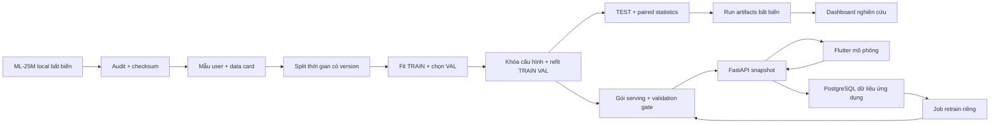

# Kế hoạch refactor MovieRS: quy trình nghiên cứu và ứng dụng khuyến nghị

Ngày lập: 15/10/2026. Cập nhật 16/10/2026: **đã triển khai P1–P7 và kiểm chứng**; xem [biên bản nghiệm thu](REFACTOR_ACCEPTANCE.md). Nội dung thiết kế/khảo sát ban đầu bên dưới được giữ để đối chiếu, các câu “chưa triển khai” mô tả thời điểm lập kế hoạch.

## 1. Mục tiêu và quyết định chính

Định hướng đề tài: **Đánh giá hệ khuyến nghị phim lai theo mức độ lịch sử người dùng trên mẫu MovieLens 25M, dưới giới hạn tài nguyên máy cá nhân**.

Đóng góp cần thể hiện là một quy trình có thể tái lập, kiểm chứng được dữ liệu, so sánh công bằng và giải thích được đánh đổi giữa độ liên quan, độ đa dạng và chi phí. Hybrid là giả thuyết cần kiểm nghiệm. Nếu baseline tốt hơn thì báo cáo kết quả đó và chọn mô hình phù hợp để vận hành; không chỉnh giao thức để hybrid thắng.

Các quyết định đề xuất:

1. Dùng **mẫu 8.000 user từ toàn bộ ML-25M, giữ nguyên lịch sử**, tương ứng **1.237.592 rating** với seed đã kiểm kê. Bản phát triển nhẹ có 4.000 user / 602.364 rating.
2. Chia thời gian toàn cục, chọn tham số trên validation, khóa cấu hình rồi refit TRAIN + VAL để đánh giá TEST. Mọi mô hình dùng chung tập ứng viên và người dùng đánh giá.
3. Giữ SVD làm thành phần nghiên cứu; so sánh với các baseline mạnh và rẻ. Đề xuất hybrid thích ứng theo độ dài lịch sử, thử MMR như một nhánh đánh đổi riêng.
4. Dashboard đọc artifacts có phiên bản, hiển thị chênh lệch ghép cặp, khoảng tin cậy, nhóm người dùng và chất lượng dữ liệu. Không huấn luyện lại khi mở trang.
5. Research artifacts ở local; Supabase PostgreSQL phục vụ dữ liệu ứng dụng qua một bước migration riêng. Huấn luyện chạy bằng CLI/worker riêng, ngoài tiến trình API.
6. Hoàn thành quy trình dữ liệu → benchmark → dashboard trước, sau đó tích hợp vận hành. Trình phát tiếp tục mô phỏng; không áp dụng Dely.

## 2. Hiện trạng đã kiểm tra

| Thành phần | Bằng chứng trong checkout | Việc cần refactor |
|---|---|---|
| Lấy mẫu | `src/data/preprocess.py` đọc toàn bộ CSV, lọc user/phim bằng số đếm toàn tập rồi lấy mẫu từng rating | Đọc theo chunk, chọn user độc lập với rating, giữ lịch sử; thống kê dùng làm feature chỉ fit trên TRAIN |
| Temporal split | `src/data/protocol.py` đã giữ các timestamp bằng nhau cùng một phía | Lưu split thành artifact bất biến; cùng cutoff cho các profile phát triển và nghiên cứu |
| Thực nghiệm | Có 3 seed, hash dữ liệu/mã, full-catalog ranking | Chốt model được chọn trên VAL, refit đúng cách, lưu metric từng user để tính chênh lệch ghép cặp |
| Lựa chọn hybrid | `train_pipeline.py` ghi cấu hình tốt nhất trên VAL nhưng vẫn xuất TEST cho ba cấu hình cố định | Tách run lựa chọn, run xác nhận và ablation đã đăng ký trước; artifact chỉ rõ cấu hình nào thực sự được chọn |
| Mẫu ranking hiện tại | Run tham chiếu có 200 user: 176 cold, 24 known | Tăng độ phủ nhóm; báo cáo quy mô mẫu và bất định, tránh dùng trung bình toàn tập che hiệu quả cá nhân hóa |
| Dashboard | Một file, bốn trang; chỉ đọc `latest.json`; có biểu đồ gộp NDCG/coverage/diversity chung thang | Tách trang và loader, chọn run, kiểm tra khả năng so sánh, biểu đồ riêng đơn vị, hiển thị chênh lệch/CI |
| Runtime | JSON/CSV, feedback có nguồn, cache và snapshot đã được sửa | Repository interfaces, giao dịch PostgreSQL, xác thực/quyền sở hữu và job huấn luyện riêng |
| Tái lập môi trường | Nhiều dependency dùng `>=`; có hai triển khai SVD | Khóa môi trường đã kiểm thử; Surprise là implementation chuẩn, NumPy giữ vai trò minh họa/đối chiếu trên fixture nhỏ |

Kết quả cũ được giữ làm **legacy protocol**. Không lấy số cũ trên mẫu 2M để tính phần trăm cải tiến của mẫu mới. Muốn đo cải tiến thuật toán phải chạy lại cả baseline và mô hình đề xuất trên cùng dữ liệu/giao thức mới.

### Kiểm kê dữ liệu nguồn và máy

Bằng chứng máy đọc được: [source_audit.json](refactor/source_audit.json).

- Đã quét toàn bộ `ratings.csv`: **25.000.095 dòng, 162.541 user, 59.047 phim có rating**; `movies.csv` có 62.423 phim.
- Không phát hiện ô trống trong bốn cột rating, rating ngoài miền/bước 0,5, cặp user–movie trùng, hoặc movie ID không có trong danh mục. Nguồn đã được xác minh sắp theo user–movie nên kiểm tra trùng liền kề bao phủ cả ranh giới chunk.
- MD5 ZIP local khớp checksum GroupLens: `6b51fb2759a8657d3bfcbfc42b592ada`. SHA-256 `ratings.csv` khớp nội dung trong ZIP, kiểm tra CRC của entry thành công. Đây là bằng chứng toàn vẹn file, không phải chứng minh mọi rating phản ánh sở thích khách quan. [Nguồn checksum](https://files.grouplens.org/datasets/movielens/ml-25m.zip.md5).
- RAM hệ thống báo **13,81 GiB**, trống khoảng **3,65–3,86 GiB** trong lần kiểm tra; 16 logical CPU. Quét nguồn theo chunk dùng khoảng 300 MiB RSS cao nhất quan sát được. Các con số này không phải benchmark huấn luyện.

ML-25M là dữ liệu rating hồi cứu; nguồn đã có điều kiện user tối thiểu 20 rating, không chứa nhân khẩu học. Phạm vi suy luận là người dùng trong dữ liệu này, không phải toàn bộ khán giả hoặc người dùng hiện nay. [README chính thức](https://files.grouplens.org/datasets/movielens/ml-25m-README.html).

## 3. Thiết kế lấy mẫu vừa sức máy

### Phương pháp chính: lấy mẫu cụm theo user

Quét toàn bộ nguồn để lấy tập ID duy nhất. Với mỗi user, tính `SHA256(UTF8("20261015:" + userId_thập_phân))`, sắp tăng theo digest dạng byte, phá hòa bằng userId. Chọn N user đầu, rồi quét lại nguồn và giữ **mọi rating** của các user đó. Lưu danh sách ID và checksum; không dùng `hash()` của Python.

Đây là cách chọn giả ngẫu nhiên tái lập từ toàn bộ quần thể user, không chọn user đầu file, user hoạt động nhiều nhất hoặc chỉ phim phổ biến. Không cắt bớt lịch sử người hoạt động nhiều để ép đúng số dòng. Mẫu được cố định trước khi đánh giá mô hình.

| Profile | User | Rating đã đếm từ nguồn | Mục đích |
|---|---:|---:|---|
| smoke | 1.000 | 157.183 | Kiểm tra CLI, schema artifacts và vòng chạy ngắn |
| dev | 4.000 | 602.364 | Phát triển thuật toán và sàng lọc cấu hình trên VAL |
| research — mặc định | 8.000 | 1.237.592 | Benchmark xác nhận và dashboard báo cáo |
| extended — tùy chọn | 12.000 | 1.874.092 | Kiểm tra độ nhạy theo quy mô khi còn tài nguyên |

Các profile là các tiền tố lồng nhau của cùng thứ tự ID. Những số dòng trên là kết quả kiểm kê, chưa tạo file sample sản xuất. `dev` và `smoke` dùng **cùng cutoff thời gian của research**, không tự tính cutoff khiến TRAIN phát triển vượt vào tương lai của research.

Mẫu research kiểm kê có 27.498 phim có rating; trung vị 71 rating/user, tối thiểu 20 trên toàn lịch sử. Khoảng cách total variation của phân phối rating so với nguồn là **0,002337**. Đây chỉ là một chỉ báo tương đồng về số sao; chưa đủ để gọi mẫu đại diện toàn diện.

Không thêm bộ lọc `min_movie_ratings=50` vào mẫu chính. Nếu mô hình cần ngưỡng hỗ trợ, ngưỡng được fit từ dữ liệu đã biết ở thời điểm huấn luyện; phim bị loại phải được thống kê và có fallback, không âm thầm loại nhãn khó khỏi TEST.

### Giới hạn và kiểm tra tính đại diện

So sánh nguồn và mẫu về số sao, năm rating, số tương tác/user, mức phổ biến phim, thể loại và phim đuôi dài. Phân biệt phân phối theo **user**, theo **rating**, theo **phim**; không trộn các mẫu số. Một số năm hiếm hoặc phim đuôi dài có thể không xuất hiện trong mẫu nhỏ.

Dùng TV distance cho số sao/thể loại và độ lệch tỷ trọng theo năm; dùng quantile/CDF cho mức hoạt động. Các cờ kiểm tra dự kiến: TV số sao >0,02 hoặc lệch tỷ trọng của một năm >2 điểm phần trăm cần giải thích. Đây là ngưỡng vận hành được đăng ký trước, không phải chứng chỉ thống kê về tính đại diện. Không đổi seed liên tục để chọn mẫu có kết quả mô hình đẹp.

Audit toàn nguồn chỉ dùng cho provenance, thống kê và lựa chọn ID; số đếm toàn nguồn không được chuyển thành feature popularity, chuẩn hóa hoặc bộ lọc huấn luyện. Mẫu cụm còn làm giảm số hàng xóm cộng tác, vì vậy vẫn phải công bố độ thưa và độ phủ phim.

### Ngân sách thực thi

- Đọc CSV theo chunk 250.000 dòng; dùng dtype gọn, ma trận sparse; lưu snapshot nghiên cứu dạng Parquet khi pipeline mới hỗ trợ.
- Một job huấn luyện tại một thời điểm; tối đa 4 thread tính toán ban đầu. Không tạo ma trận user × item hay item × item dạng dense đầy đủ.
- Mục tiêu RSS cả cây tiến trình job ≤2 GiB trên máy hiện tại; chỉ chạy nếu còn ≥3 GiB RAM trống. Watchdog đo tổng RSS của tiến trình con, dừng có checkpoint khi vượt ngân sách. Thay đổi giới hạn phải ghi trong manifest.
- ItemKNN tính similarity theo block, chỉ giữ top 100 hàng xóm/phim. Chấm ranking theo batch nhỏ, tái sử dụng bộ điểm SVD cho các ablation hybrid.
- Ngân sách dự kiến: smoke ≤5 phút; dev ≤20 phút; đợt research ≤120 phút. Đây là giới hạn để thiết kế và đo pilot, chưa phải thời gian đã đạt.
- Nếu không đủ RAM/thời gian, giảm profile hoặc số cấu hình từ trước run; đánh dấu run chưa hoàn tất. Không giảm tập ứng viên riêng cho mô hình chậm rồi so trực tiếp với các mô hình khác.

## 4. Giao thức đánh giá phải khóa trước khi chạy

### Ranh giới thời gian và vòng đời run

1. Chuẩn hóa UTC; sắp `(timestamp, userId, movieId)`; tạo ranh giới khoảng 80/10/10 và giữ timestamp bằng nhau cùng phía.
2. Cutoff research đã tính trong kiểm kê: `T1=2016-07-25T17:31:14Z`, `T2=2018-01-23T19:51:49Z`. Tương ứng 990.073 TRAIN, 123.759 VAL, 123.760 TEST. Pipeline mới phải tái tạo và kiểm tra các giá trị này khi nguồn/seed giống nhau.
3. Fit mô hình và mọi thống kê chỉ trên `t<T1`; chọn cấu hình trên VAL `[T1,T2)`. Catalog validation chỉ gồm phim đã có trong TRAIN.
4. Ghi `selected_config.json`, khóa danh sách baseline, ablation, metric và ngân sách. Refit cấu hình đã chọn trên `t<T2` cho tất cả các mô hình cần fit.
5. Đánh giá một đợt TEST `t>=T2` cho các cấu hình đã đăng ký; catalog TEST là phim đã có trong TRAIN+VAL. Không dùng kết quả TEST để đổi trọng số hay chọn mô hình mặc định.
6. Nếu thay giả thuyết sau khi đọc TEST, đánh dấu thăm dò, tạo phiên bản giao thức mới và xác nhận ở một holdout tương lai chưa dùng nếu dữ liệu cho phép. Đổi tên run không làm TEST trở thành holdout mới.

Các kết quả V1 trên cùng nguồn ML-25M đã được xem trong quá trình phát triển. Vì vậy phải ghi nhận lịch sử sử dụng dữ liệu: V2 là xác nhận theo giao thức mới đã khóa, không tuyên bố đây là một thử nghiệm mù hoàn toàn trên nguồn chưa từng khảo sát. Các thống kê kiểm kê trong kế hoạch không được dùng để chọn seed hoặc trọng số theo hiệu quả mô hình.

Giữ giao thức thời gian toàn cục vì chia riêng từng user có thể cho mô hình học tương tác tương lai của user khác. [Ji và cộng sự, TOIS 2023](https://arxiv.org/abs/2010.11060).

### Bài toán được đo

Bài toán chính là **gợi ý Top-K tại đầu một cửa sổ tương lai**, sử dụng lịch sử đã có trước cửa sổ. Không cập nhật model hoặc profile bằng chính nhãn trong cửa sổ đang chấm. Timestamps là thời điểm rating, không khẳng định đó là thời điểm xem phim.

- Positive: rating ≥3,5, đăng ký trước. K chính là 10; K=5/20 là phân tích bổ sung.
- Chấm **toàn bộ catalog đã biết**, trừ phim user đã tương tác trước cutoff. Không lấy 99/999 phim âm tính để báo điểm chính. Lấy mẫu item có thể làm thay đổi thứ tự tương đối giữa mô hình. [Krichene & Rendle, KDD 2020](https://research.google/pubs/on-sampled-metrics-for-item-recommendation/).
- Đầu ra ranking có điểm riêng; điểm này không được gọi là xác suất thích hoặc tự động đổi thành số sao.
- Mọi mô hình dùng cùng ID user, candidate policy, lịch sử và tie-break `(score giảm, movieId tăng)`.
- Nhãn chưa quan sát chỉ là nonrelevant trong phép đo offline; không gọi đó là dislike thật.

### Người dùng, phim ngoài catalog và mẫu số

Nhóm user theo số rating trước cutoff: `cold_0`, `sparse_1_4`, `warm_5_19`, `heavy_20_plus`. Giữ cả user mới; không giả lập sở thích onboarding từ TEST.

Metric chính: **macro NDCG@10 trên user có ít nhất một positive trong cửa sổ**. Tập relevant chính giữ cả positive ngoài catalog; chúng không thể được khuyến nghị và làm giảm điểm. User có toàn bộ positive ngoài catalog vẫn được tính với điểm 0. Precision chia cho K; Recall chia cho toàn bộ positive của user; IDCG dùng `min(K, số positive)`.

Xuất thêm bảng **conditional-on-servable** với relevant giới hạn trong catalog, nhãn và mẫu số riêng. Không dùng bảng có loại nhãn khó này để thay headline metric. Báo số user không có positive và tỷ lệ positive ngoài catalog; không biến Recall không xác định của user không có positive thành 1.

Mẫu research hiện có 903 user xuất hiện trong TEST; sau refit TRAIN+VAL có 342 known và 561 cold. Khoảng 75,29% rating TEST thuộc cold user, khoảng 7,30% positive nằm ngoài catalog 22.821 phim. Chưa tính đây là số user đủ điều kiện ranking vì còn điều kiện positive. Những số này cho thấy giữ toàn bộ lịch sử không tự giải quyết cold-start.

Giới hạn ranking research là 1.000 user; với snapshot hiện tại có thể chấm toàn bộ user đủ điều kiện vì tổng user TEST là 903. Nếu profile khác vượt 1.000, lấy mẫu user đồng đều bằng seed cố định và dùng cùng mẫu cho mọi mô hình. Bảng nhóm dùng mẫu này; mẫu bổ sung theo nhóm chỉ báo riêng, hoặc phải có trọng số lấy mẫu khi ước lượng trung bình toàn quần thể.

### Metric và bất định

| Nhóm | Phép đo | Cách diễn giải |
|---|---|---|
| Chính | NDCG@10 macro theo user | Chất lượng thứ tự Top-10 ở giao thức đã khóa |
| Liên quan | Recall@10, Precision@10, HitRate@10 | Công bố mẫu số, nhóm user và positive ngoài catalog |
| Rating | RMSE, MAE trên toàn bộ TEST; nhóm user/item đã biết/chưa biết | Chỉ áp dụng cho mô hình dự đoán rating; model chỉ ranking hiển thị N/A |
| Đa dạng | Catalog coverage, genre ILD, novelty theo tần suất dữ liệu fit | Proxy về danh sách, không phải bằng chứng hài lòng người dùng |
| Tài nguyên | Training time, tổng peak RSS, model size, p50/p95 thời gian suy luận | Đo cùng máy, workload và cách cache; tách scoring model khỏi HTTP/API |

Lưu từng metric theo `(run, model, seed, user, cohort)`. Chạy seed huấn luyện 42/43/44 cho mô hình ngẫu nhiên; baseline xác định không tạo ba bản sao để giả tăng cỡ mẫu.

So sánh chính: hybrid đã chọn với baseline có NDCG VAL tốt nhất, chọn baseline trước khi mở TEST. Lấy trung bình metric mỗi user qua các seed, rồi **bootstrap ghép cặp user** 2.000 lần để tính CI95 cho chênh lệch. Không coi `user × seed` là các quan sát độc lập. Độ dao động giữa seed trình bày riêng; CI trên user vẫn có điều kiện theo snapshot/cutoff/seed đã chạy.

Dashboard hiển thị Δ tuyệt đối, Δ tương đối nếu baseline khác 0 và CI của Δ. Chỉ ghi “có bằng chứng cải thiện” khi CI của Δ vượt 0 trong so sánh chính; nếu cắt qua 0 thì ghi “chưa đủ bằng chứng”. Báo cả độ lớn hiệu ứng và chi phí, không chỉ nhãn thống kê. Các so sánh phụ là thăm dò; nếu muốn tuyên bố nhiều so sánh cùng lúc phải đăng ký và hiệu chỉnh kiểm định, ví dụ Holm.

Không dùng ba seed huấn luyện thay cho ba mẫu dữ liệu. Kiểm tra độ nhạy theo seed lấy mẫu/cửa sổ thời gian là thí nghiệm riêng. V1 chỉ kết luận cho snapshot chính; mở rộng khi ngân sách cho phép.

## 5. Ma trận mô hình và giả thuyết cải tiến

| Mô hình | Vai trò | Phép đo |
|---|---|---|
| Global mean / regularized user-item bias | Baseline rating tối thiểu, xác định phần lợi ích từ bias | RMSE/MAE |
| MostPopular theo số rating đã biết | Baseline ranking mạnh, rẻ | Top-K |
| Bayesian item mean hiện tại | Đối chứng gần với ứng dụng hiện tại; không gộp tên với MostPopular | Rating + Top-K |
| Genre content | Hồ sơ thể loại từ lịch sử đã biết | Top-K |
| ItemKNN sparse, positive co-occurrence/cosine và shrinkage | Đối chứng collaborative ranking không dùng latent factors | Top-K |
| Biased SVD bằng Surprise | Mô hình nền hiện tại; tối ưu rating, kiểm tra ranking riêng | Rating + Top-K |
| Hybrid thích ứng SVD + genre + Bayesian popularity | Mô hình đề xuất | Top-K; rating component báo riêng nếu cần |
| Hybrid + MMR | Kiểm tra đánh đổi liên quan–đa dạng | Top-K + ILD/coverage + chi phí |

SVD ở đây là factorization có bias được học bằng SGD, không mô tả như phép phân rã SVD đại số tuyến tính trực tiếp. [Tài liệu Surprise](https://surprise.readthedocs.io/en/stable/matrix_factorization.html).

BPR hoặc implicit ALS là nhánh mở rộng sau benchmark lõi, không điều kiện bắt buộc để hoàn thành V1. Nếu triển khai, phải kiểm tra hỗ trợ Windows/Python, khai báo cách chuyển rating thành positive và giữ cùng giao thức evaluation; sampling dùng trong **huấn luyện** không đồng nghĩa được sampling item trong **đánh giá**. [BPR, Rendle và cộng sự](https://arxiv.org/abs/1205.2618).

### Hybrid đề xuất

Với `n` là số tương tác đã biết, dùng `w=n/(n+tau)` và kết hợp:

`score = w * norm(SVD) + (1-w) * [beta * norm(genre) + (1-beta) * norm(popularity)]`.

Chuẩn hóa điểm bằng rank-percentile trên cùng candidate set của user, xử lý tie nhất quán; không cần đọc nhãn tương lai. Nếu không có genre profile thì chuyển phần trọng số đó về popularity. User không có lịch sử dùng popularity; không tuyên bố cá nhân hóa khi chưa có thông tin. `tau ∈ {5,20}`, `beta ∈ {0,0.25,0.5,0.75}` là tối đa 8 cấu hình ban đầu, chọn trên VAL.

Đây là giả thuyết thiết kế, chưa phải thuật toán đã chứng minh tốt hơn. Mô hình có thể không vượt ItemKNN hoặc MostPopular. Cold-user fallback phải được công bố cho từng baseline; chạy thêm SVD với cùng fallback để phân biệt lợi ích của fallback với lợi ích của blending.

Ablation đăng ký: SVD thuần; SVD + cùng cold fallback; hybrid trọng số cố định; hybrid thích ứng bỏ genre; hybrid đầy đủ; hybrid + MMR. Giữ chung SVD đã fit khi so các lớp rerank. MMR dùng top-200 sau scoring toàn catalog; thử `lambda ∈ {0,0.05,0.1,0.2}` trên VAL. Báo đường đánh đổi NDCG–ILD, không chọn lambda sau khi nhìn TEST. [MMR, Carbonell & Goldstein](https://www.cs.cmu.edu/~jgc/publication/The_Use_MMR_Diversity_Based_LTMIR_1998.pdf).

Giới hạn tìm kiếm đầu tiên: SVD tối đa 4 cấu hình `(factors,epochs,reg)`: `(32,15,0.02)`, `(32,20,0.05)`, `(64,15,0.05)`, `(64,20,0.1)`; ItemKNN tối đa 3 cấu hình `(neighbors,shrinkage)`: `(50,10)`, `(100,10)`, `(100,50)`. Sàng lọc trên dev/VAL rồi xác nhận cấu hình trên research/VAL. Ghi số trial và chi phí của mọi mô hình, kể cả trial thất bại.

## 6. Độ tin cậy dữ liệu: bằng chứng phải xuất được

Tạo **data card** và báo cáo chất lượng có phiên bản cho mỗi snapshot. Không gộp thành một “độ tin cậy 98%” thiếu cơ sở.

| Lớp kiểm chứng | Bằng chứng cần có | Trạng thái/nguyên tắc |
|---|---|---|
| Nguồn gốc | URL, phiên bản, checksum ZIP, SHA-256 các đầu vào, ngày tải nếu biết | Ngày tải không biết thì ghi unknown, không suy từ file mtime |
| Toàn vẹn | Kiểu dữ liệu, ID, miền/bước rating, timestamp, trùng, null, FK movies/links | Lỗi cứng làm pipeline dừng; xuất mẫu lỗi đã loại dữ liệu cá nhân |
| Biến đổi | Số dòng vào/ra, số bị loại theo lý do, config/hash và version mã | Không âm thầm drop lỗi; có quarantine và biên bản quyết định |
| Lấy mẫu | Seed, danh sách user/hash, xác suất chọn user N/U, phân phối nguồn/mẫu | Không khẳng định đại diện cho nhóm dân số không có dữ liệu |
| Thời gian | Cutoff, overlap cặp, max TRAIN < min VAL, max VAL < min TEST | Cùng timestamp không vượt ranh giới; fit không đọc holdout |
| Metadata | Nguồn từng trường, missing rate, link match, fetched_at, giá trị thay thế | Runtime 100 phút là giá trị mô phỏng nếu impute, không phải runtime thật |
| Khả năng tái lập | Hash snapshot/split/config, versions, git commit và dirty source hashes | Artifacts thiếu nguồn gốc bị đánh dấu incomplete |

Benchmark chính dùng genre từ `movies.csv` gốc. Metadata TMDB phục vụ giao diện; vote average/count lấy hiện tại không được dùng như feature cho đánh giá lịch sử. Tag Genome là dữ liệu tổng hợp từ nhiều nguồn/tương tác nên chưa đưa vào benchmark thời gian chính. Genre snapshot cũng là thuộc tính hồi cứu; ghi rõ giả định này thay vì tuyên bố metadata có đầy đủ version lịch sử.

Các hạn chế luôn hiển thị: rating do người dùng tự chọn cung cấp; phim chưa được rating không có nhãn dislike; thiếu exposure/impression và demographic; thời gian kết thúc năm 2019; đánh giá offline không chứng minh hiệu quả A/B hay sự hài lòng thật.

## 7. Dashboard nghiên cứu đề xuất

Giữ Streamlit để tiết kiệm công sức vận hành; tách UI, data loader và phép tính. Các giá trị đều đọc từ artifacts đã xác thực schema/hash. Mọi trang có `dataset_id`, `protocol_id`, `run_id`, trạng thái hoàn tất và thời điểm tạo.

| Trang | Nội dung và tương tác chính |
|---|---|
| Tổng quan nghiên cứu | Câu hỏi, mô hình đang xét, kết luận có bằng chứng/chưa đủ bằng chứng, giới hạn |
| Dữ liệu & provenance | Nguồn → audit → sample → split; số dòng, hash, kiểm tra chất lượng, cold/known và phim ngoài catalog |
| Tính đại diện của mẫu | Nguồn/mẫu theo số sao, năm, hoạt động user, popularity và genre; định nghĩa mẫu số |
| So sánh mô hình | Leaderboard, lọc cohort/K, biểu đồ NDCG với CI, Δ so baseline, bảng RMSE riêng, tải CSV |
| Phân tích đóng góp | Ablation, paired Δ theo nhóm, NDCG–diversity Pareto, chi phí theo mô hình |
| Khuyến nghị minh họa | Cùng user/cùng cutoff/cùng ứng viên; hai danh sách cạnh nhau, lý do/điểm thành phần, history chỉ trước cutoff |
| Vận hành | Model version đang phục vụ, last job, latency/cache, PostgreSQL health; phân biệt research run với serving version |

Thiết kế hiển thị:

- Mỗi metric có biểu đồ và đơn vị phù hợp; không đặt NDCG 0,02 và diversity 0,8 trên một biểu đồ khiến NDCG không đọc được.
- Luôn có baseline được chọn, Δ tuyệt đối/tương đối, cỡ mẫu, CI và missing/timeout. Giá trị thiếu hiển thị N/A, không thành 0.
- Chỉ cho so sánh trực tiếp các run cùng snapshot, cutoff/refit, user selection, relevance, candidate policy và K. Metadata hash cũng phải khớp khi thuật toán dùng metadata. Run khác giao thức xem cạnh nhau với nhãn “không tính Δ”.
- Không tạo nhãn “cải thiện” chỉ vì một cột tăng; MMR có thể tăng đa dạng và giảm liên quan.
- Phần demo có thể cho người xem thay trọng số nhưng hiển thị là thử nghiệm tương tác, không sửa leaderboard xác nhận.
- Trang chưa có kết quả cho biết cần run nào; không điền dữ liệu minh họa vào biểu đồ kết quả.

## 8. Kiến trúc kỹ thuật và ranh giới module



Đây là kiến trúc đích, chưa phản ánh toàn bộ thành phần đang chạy. Việc chọn gói serving dựa trên validation và guardrail đã khai báo; TEST dùng báo cáo, không trở thành vòng tuning/promotion lặp lại.

Tách dần trong cấu trúc hiện tại, giữ wrapper CLI cũ trong thời gian chuyển đổi:

```text
configs/                  # TOML: data, protocol, models, resource profiles
src/data/                 # audit, sampling, quality, snapshots, split
src/models/               # interfaces, baselines, SVD, ItemKNN, hybrid
src/evaluation/           # candidates, cohorts, metrics, paired statistics
src/experiments/          # config validation, runner, artifact schema, registry
src/pipeline/             # serving training jobs, promotion, rollback
api/services/             # nghiệp vụ và điều phối inference
api/repositories/         # interfaces, file adapter, PostgreSQL adapter
dashboard/pages/          # các trang nghiên cứu
dashboard/services/       # artifact loader và kiểm tra khả năng so sánh
tests/                    # unit, protocol, integration, dashboard smoke
data/snapshots/<id>/       # sample + splits + manifests, Git ignored
artifacts/runs/<run_id>/   # summary + per-user metrics + config + logs
artifacts/serving/<id>/    # model + feature contract + validation metadata
```

Chuẩn hóa config bằng TOML + Pydantic; `.env` chỉ giữ secrets và môi trường vận hành. Thêm `pyproject.toml`/lock hoặc constraints cho bộ phiên bản đã chạy được; chọn Python được các thư viện hỗ trợ sau smoke môi trường sạch, không tự đổi Python đang dùng chỉ để hợp một thư viện tùy chọn.

Interface tối thiểu cho model: `fit`, `score_items`, `save/load`, metadata capability `supports_rating_prediction`. `predict_rating` chỉ bắt buộc khi capability này có; evaluator không tự ép điểm ItemKNN/content thành rating. `ranking_score`, `predicted_rating`, `reason` là ba trường có ý nghĩa khác nhau.

Artifact mỗi run gồm:

- `manifest.json`: ID, trạng thái, protocol/config/data/code/environment hashes, input/output lineage, resource budget, seed và exclusions.
- `selection.json`: chỉ tiêu VAL, trial hoàn thành/thất bại, cấu hình và baseline được chọn.
- `metrics.json` và `per_user_metrics.parquet`: rating/ranking/cohort, seed; dữ liệu đủ để tính lại paired CI.
- `comparisons.json`: comparator đã đăng ký, Δ, CI, điều kiện suy luận; `resource_usage.json` và log.
- `model_card.md`: mục đích, training snapshot, hạn chế, fallback và trạng thái đủ điều kiện phục vụ.

Artifacts được ghi vào thư mục tạm rồi đổi tên khi hoàn tất; trạng thái `failed/cancelled` không được xuất như run thành công. `latest` chỉ là con trỏ tiện dùng. Resume theo stage hash; không dùng cache nếu nguồn hoặc config khác.

### Tích hợp PostgreSQL sau benchmark lõi

PostgreSQL đã kiểm tra kết nối ở lượt trước; schema và runtime migration chưa hoàn tất. Kế hoạch mới cần:

1. Định nghĩa repository cho user, feedback, favorites và watch progress; contract test chạy cùng bộ tình huống trên adapter file và PostgreSQL.
2. Dùng schema riêng, migrations có version, FK/unique/check/index theo truy cập thực tế. RLS và quyền schema phải phù hợp với đường truy cập; không coi bật RLS là đã bảo vệ được kết nối owner bypass RLS. [Tài liệu RLS Supabase](https://supabase.com/docs/guides/database/postgres/row-level-security).
3. Thêm xác thực session/token và kiểm tra quyền sở hữu ở API trước khi phục vụ nhiều người dùng. Chọn FastAPI quản lý session và password hash Argon2id để giữ luồng client hiện tại; tài khoản prototype được nâng hash sau lần đăng nhập hợp lệ hoặc reset, không thể chuyển hash cũ thành mật khẩu mới. Nếu đổi sang Supabase Auth thì phải ghi một quyết định kiến trúc thay thế, không duy trì hai hệ danh tính song song.
4. Việc thêm favorite + feedback và watch-complete + feedback phải cùng transaction; idempotency key, upsert/unique, concurrency test và invalidation sau commit. Mất DB phải báo lỗi, không tự fallback ghi CSV gây chia đôi dữ liệu.
5. Export có checksum, chạy dry-run kiểm đếm, nhập dữ liệu ứng dụng idempotent, đối soát ID/đếm/trạng thái, chuyển một nguồn ghi duy nhất. Giữ bản sao file để rollback; nếu đã phát sinh ghi mới ở PostgreSQL thì rollback cần export/replay các ghi đó, không đơn thuần bật lại CSV cũ.
6. ML-25M và model lớn vẫn là artifact local; không upload toàn bộ 25M vào database ứng dụng. App feedback có nguồn, thuộc vận hành, không vào holdout nghiên cứu.
7. Tách retrain khỏi API; demo mặc định manual. Worker đơn với khóa job, trạng thái rõ ràng, snapshot phục vụ thay nguyên tử và rollback model. Cổng promotion xem NDCG validation cùng guardrail rating/latency/cohort thay vì chỉ RMSE; không relax gate để hợp metric cũ.

## 9. Lộ trình triển khai và tiêu chí nghiệm thu

Ưu tiên theo dependency; mỗi pha tạo được đầu ra có thể kiểm tra trước khi đi tiếp.

| Pha | Công việc | Tiêu chí hoàn thành |
|---|---|---|
| P0 — khảo sát, hiện đã làm | Kiểm kê nguồn/máy, đọc code, chọn câu hỏi và protocol | Kế hoạch này + audit nguồn + đặc tả benchmark có thể review; chưa coi pipeline mới đã tồn tại |
| P1 — nền tảng tái lập | Config schema, môi trường khóa, logging, model interface, manifest/version | Smoke trong môi trường sạch; config sai bị từ chối; secrets không vào artifact |
| P2 — dữ liệu | Audit CLI, sampler user theo chunk, snapshot, cutoff chung, data card | Tái tạo đúng 1.237.592 dòng/8.000 user; không trùng/overlap; cùng seed cùng ID/hash; đọc CSV có thứ tự khác vẫn cùng kết quả sau canonicalization |
| P3 — evaluation | Candidate/cohort/metrics, refit, paired bootstrap, test access discipline | Fixture nhỏ tính tay khớp; future mutation không đổi model/train feature; user toàn positive ngoài catalog được điểm 0; CI ghép đúng user |
| P4 — mô hình & experiment runner | Baseline, SVD, ItemKNN, hybrid, ablation, tài nguyên và resume | Baseline chạy cùng giao thức; VAL chọn thật cấu hình; TEST dùng cấu hình khóa; đủ 3 seed khi cần; timeout không bị bỏ khỏi báo cáo |
| P5 — dashboard | Các trang dữ liệu/so sánh/ablation, lựa chọn run, downloads | Từng con số truy về artifact; không so Δ sai protocol; test trạng thái thiếu/lỗi/incomplete; chart CI đọc được |
| P6 — ứng dụng & database | Repository, migrations, auth, import, feedback transaction, job riêng | Tài khoản không đọc/ghi dữ liệu người khác; migration idempotent và rollback đã diễn tập; API/Flutter giữ luồng chức năng; offline benchmark không bị app làm thay đổi |
| P7 — nghiệm thu & báo cáo | Chạy research đã khóa, data/model cards, kịch bản demo, tài liệu cài đặt | Một quy trình chạy lại được từ raw local; số dashboard khớp bảng báo cáo; giới hạn và kết quả âm được trình bày; kiểm thử backend/Flutter/web/HTTP đạt |

Critical path: **P1 → P2 → P3 → P4 → P5 → P7**. P6 hoàn tất trước nghiệm thu ứng dụng ở P7, nhưng không chặn kết quả nghiên cứu. Mỗi pha nên chia thành thay đổi nhỏ theo module; tránh viết lại toàn bộ repo cùng lúc.

Các command của CLI mới sẽ được chốt ở P1; tài liệu này không đưa lệnh chưa tồn tại như lệnh có thể chạy ngay. Lệnh hiện có vẫn giữ theo README trong thời gian chuyển đổi.

### Checklist nghiệm thu toàn dự án

- [x] Source/snapshot/split có lineage và checksum; data card có missingness, tính đại diện và hạn chế.
- [x] Bộ benchmark chung, baseline đủ mạnh, cấu hình chọn trên VAL và locked TEST rõ ràng.
- [x] Có kết quả từng user, paired Δ/CI, cohort và chi phí; không ép kết luận hybrid thắng.
- [x] Dashboard kiểm tra protocol trước khi so sánh và đọc hoàn toàn từ artifact.
- [x] Research artifacts bất biến, không nhận feedback hoặc online update từ demo.
- [x] Runtime dùng một storage được chỉ định; có transaction, auth, job riêng và rollback.
- [x] `python -m pytest -q`, HTTP smoke, Streamlit smoke, `flutter analyze`, `flutter test`, `flutter build web` đạt ở phiên bản refactor.
- [x] Benchmark RAM/thời gian chạy trên máy thật đạt budget hoặc có điều chỉnh profile được ghi trước run xác nhận.
- [x] Báo cáo mô tả đúng phạm vi: offline trên mẫu ML-25M; player mô phỏng; không coi proxy xem xong là nhãn explicit.

**Thành công của refactor được đánh giá bằng tính đúng đắn và khả năng kiểm chứng của toàn quy trình. “Hybrid tốt hơn mọi mô hình” không phải điều kiện nghiệm thu.**

## 10. Bàn giao của giai đoạn lập kế hoạch

- Tài liệu này: quyết định, giao thức, kiến trúc, dashboard, dependency và tiêu chí nghiệm thu.
- [Đặc tả benchmark dạng JSON](refactor/benchmark_plan.json): cấu hình đề xuất, có trạng thái `planned`; chưa được runner hiện tại sử dụng.
- [Audit nguồn và kích thước mẫu](refactor/source_audit.json): kết quả kiểm tra đọc thực tế; sample research chỉ dựng tạm trong RAM để kiểm kê, chưa lưu thành dataset thay thế.

Bước triển khai kế tiếp đã xác định là **P1 và P2**, sau đó mới huấn luyện/so sánh bằng P3–P4. Các bảng model và dashboard đề xuất ở trên chưa phải kết quả thực nghiệm mới.
